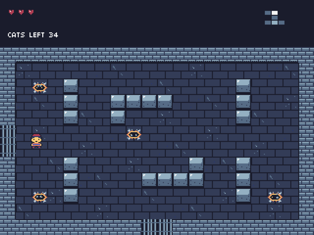

Toast Framework
===============

Toast is an easy-to-use 2D game framework for C++, inspired by
[FlashPunk](https://github.com/useflashpunk/FlashPunk). If you know AS3 and
FlashPunk, you already know how a Toast game is put together: a `World` full of
`Entity` objects, each drawn by a `Graphic`. Toast runs natively on macOS, Linux
and Windows on top of [SDL3](https://libsdl.org).

It's perfect if you want to switch from AS3 to C++ in the most painless way
possible, and for learning C++ while doing what you love: making games.

<p align="center">
  
</p>

Features
--------------------------------------
- **FlashPunk-style structure**: `World`, `Entity` and `Graphic`, with global access
  to the engine, the current world, the camera and the frame time through `TF`.
- **Graphics**: images, animated sprite sheets (`Spritemap`), tilemaps that draw
  only the tiles on screen, TrueType text, and off-screen canvases. Alpha, scale,
  rotation and flipping are built in.
- **Particles**: an `Emitter` in the style of FlashPunk's. Define named particle
  types on frames of one texture, then `emit` them; each particle moves in a
  straight line with gravity while its alpha and scale change over its life.
- **Camera** with per-graphic scroll factors for parallax.
- **Any window size**: the game draws at a fixed resolution that you choose. The
  window opens at the largest whole multiple of it that fits in 80% of the screen, and Toast
  scales it to any window size or the full screen with black bars, sharp on HiDPI and
  Retina displays. Mouse coordinates are always in game coordinates. Pixel-art
  games call `setPixelArt(true)` in their `Engine` constructor, before loading any
  art, to get nearest-neighbour scaling.
- **Input**: keyboard (`TOAST_KEY_*` codes; "pressed this frame" and "held down")
  and mouse.
- **Safe removal**: `World::removeLater` lets an entity remove itself, or another
  one, while the world is updating.
- **Collision**: test an entity's hitbox against a rectangle with
  `Entity::collideRect`, and store solid tiles in a `Grid` you query with `getTile`.
  Collision between `Mask` types (`Hitbox` against `Hitbox` or `Grid`) is not
  finished yet and always reports no collision.
- **Debug console**: press ENTER to pause the game, see every entity's hitbox, and
  select or drag entities with the mouse. It is off by default; turn it on in your
  `Engine` constructor with `TF::debug = true; TF::console->enable();`.
- **Assets** load from the executable's directory, so games run from any working
  directory.

Quick start
--------------------------------------
You need CMake and SDL3 with SDL3_image and SDL3_ttf.

macOS (Homebrew):

    brew install cmake sdl3 sdl3_image sdl3_ttf
    cmake -B build
    cmake --build build
    ./build/roguelike

Linux and Windows: install SDL3, SDL3_image and SDL3_ttf with your package manager
or vcpkg, then run the same CMake commands. If you do not have them, configure with
`cmake -B build -DTOAST_FETCH_DEPS=ON`, and CMake downloads and builds them for you.

The build copies the game's assets next to its executable.

### The sample game

`ROGUELIKE/` holds Cat Crypt, a small shooter that uses most of the framework.

| Key | What it does |
|---|---|
| WASD | Walk |
| Left mouse button (aim with the mouse), or an arrow key | Spit |
| R | Start a new crypt |
| ENTER | Toggle the debug console (drag to select, Shift+drag to move) |
| ESC | Quit |

### How Cat Crypt works



An EarthBound-style kid is lost in a crypt full of crazy cats. Each room is one
screen. When he walks into a room for the first time, its doors close, and glowing
cracks in the floor show where 2 to 5 cats will dig out, more the deeper you go.
Orange cats zig-zag straight at him; grey ones crouch for a moment, then pounce.
Three hits kill a cat in a burst of fur. Clear every room and the last cat drops
the key to the golden door of the locked room: get there to escape. The kid has
three hearts.

- **The maze** comes from the *Growing Tree* algorithm on a 9×7 grid of rooms,
  stopped at 12 rooms. Every step adds a room or retires a cell, so it ends in at
  most 2N steps and never retries; a test builds a 10,000-room maze in under 50 ms.
  The locked room is the farthest room with a single door.
- **Rooms** are written as ASCII templates in `ROGUELIKE/rooms/rooms.txt`, with
  walls, rocks, pots, crates, bones, grass and cat spawn points. A test checks that
  props never cut off any part of a room from its doors.
- **Cats** follow the shortest path round walls (a BFS over the room's tiles)
  whenever they cannot see the kid.
- **The pixel art** is text too: `ROGUELIKE/art/*.txt` hold a 16-colour palette and
  frames written as characters, and `cmake --build build --target roguelike_art`
  turns them into the PNGs in `ROGUELIKE/assets/`. The PNGs are committed, and a
  test fails when one no longer matches its source.
<br clear="right">

Make your own game
--------------------------------------
A game is an `Engine` subclass that sets the first `World`:

```cpp
#include "Toast.h"
#include "ToastEntity.h"
#include "ToastImage.h"
#include "ToastInput.h"
#include "ToastWorld.h"
#include <SDL3/SDL_main.h>   // in main.cpp only

using namespace Toast;

class MyWorld : public World
{
public:
	MyWorld()
	{
		player = new Entity(100, 100);
		player->graphic = new Image("player.png");
		add(player);
	}

	virtual void update()
	{
		World::update();

		if(Input::down(TOAST_KEY_LEFT))  player->x -= 200 * TF::elapsed;
		if(Input::down(TOAST_KEY_RIGHT)) player->x += 200 * TF::elapsed;
		if(Input::pressed(TOAST_KEY_ESCAPE)) TF::engine->onExit();
	}

private:
	Entity* player;
};

class MyGame : public Engine
{
public:
	MyGame() : Engine(1280, 720)   // game resolution; scaled to fit the window
	{
		TF::world = new MyWorld();
	}
};

int main(int argc, char* argv[])
{
	MyGame game;
	return game.run();
}
```

Add it to `CMakeLists.txt` and list its assets. The engine's default font,
`04B_03__.TTF`, must ship with every game:

```cmake
add_executable(mygame MyGame/main.cpp)
target_link_libraries(mygame PRIVATE toast)
toast_copy_assets(mygame
    ${CMAKE_SOURCE_DIR}/MyGame/player.png
    ${CMAKE_SOURCE_DIR}/ROGUELIKE/04B_03__.TTF)
```

The world owns what you add to it: `World::remove()` and the world's destructor
delete entities and graphics. Cat Crypt in `ROGUELIKE/` shows a complete game.

Project layout
--------------------------------------
| Directory | Contents |
|---|---|
| `ToastFramework/` | The framework, built as the `toast` static library |
| `ROGUELIKE/` | Cat Crypt (`rooms/rooms.txt` holds the room templates, `art/` the pixel art sources) |
| `tools/` | `pixelart`, which turns the ASCII art into PNG sheets |
| `tests/` | Unit and integration tests |

Tests
--------------------------------------
    ctest --test-dir build --output-on-failure      # all tests
    ctest --test-dir build -R input_keymap          # one test

Most tests run without a display. A few check GPU rendering and are reported as
skipped on machines without a GPU. Configure with `-DTOAST_SANITIZERS=undefined`
(or `address,undefined`) to build with sanitizers.

Platforms
--------------------------------------
Toast is built and tested on macOS (Apple Silicon). The CMake build is written for
Linux and Windows too, but nobody has tried it there yet. Reports and fixes are
welcome!

Toast started in 2013 on Allegro 5 and Visual Studio 2012. In 2026 it moved to
SDL3 and CMake, keeping its game-facing API.

Contribution
--------------------------------------
The code is thoroughly commented, but if you run into any problem, let me know! :)

In the spirit of open source software development, I always encourage community code contribution, so let's make a fork!
Just please let me know if you do something interesting with it.

License
--------------------------------------
[MIT License](http://opensource.org/licenses/mit-license.php)

&copy; 2013 Danny Calleri &lt;daniele.calleri@gmail.com&gt;

Permission is hereby granted, free of charge, to any person obtaining a copy of this software and associated documentation files (the "Software"), to deal in the Software without restriction, including without limitation the rights to use, copy, modify, merge, publish, distribute, sublicense, and/or sell copies of the Software, and to permit persons to whom the Software is furnished to do so, subject to the following conditions:

The above copyright notice and this permission notice shall be included in all copies or substantial portions of the Software.

THE SOFTWARE IS PROVIDED "AS IS", WITHOUT WARRANTY OF ANY KIND, EXPRESS OR IMPLIED, INCLUDING BUT NOT LIMITED TO THE WARRANTIES OF MERCHANTABILITY, FITNESS FOR A PARTICULAR PURPOSE AND NONINFRINGEMENT. IN NO EVENT SHALL THE AUTHORS OR COPYRIGHT HOLDERS BE LIABLE FOR ANY CLAIM, DAMAGES OR OTHER LIABILITY, WHETHER IN AN ACTION OF CONTRACT, TORT OR OTHERWISE, ARISING FROM, OUT OF OR IN CONNECTION WITH THE SOFTWARE OR THE USE OR OTHER DEALINGS IN THE SOFTWARE.

For more information, see the accompanying "MIT-LICENSE.txt" file.
